<picture>
  <source media="(max-width: 600px)" srcset="assets/banner-mobile.svg">
  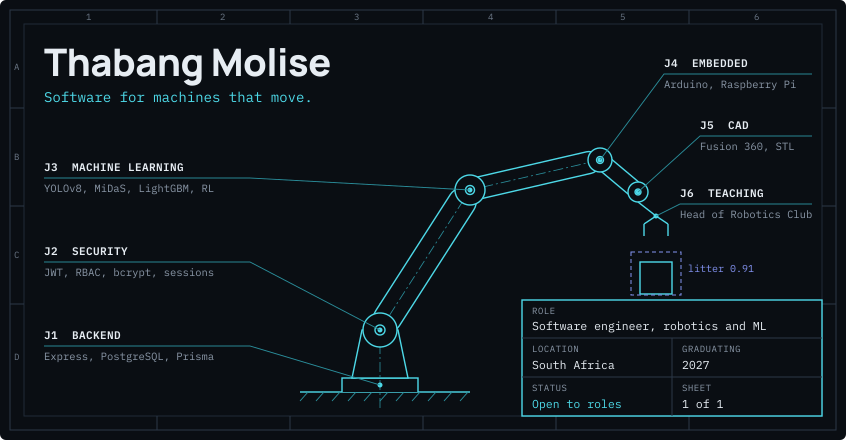
</picture>

I'm a final-year Software Engineering student at Belgium Campus iTversity, writing the software that makes small machines see, decide and move. I started in backends, moved into hardware while building a litter-collecting robot with a friend, and now work across Arduino, Raspberry Pi, Fusion 360 and machine learning.

## Bill of materials

<picture><source media="(max-width: 600px)" srcset="assets/bom-header-mobile.svg">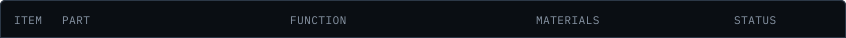</picture> 
<a href="https://lethasky.co.za/project-agc.html"><picture><source media="(max-width: 600px)" srcset="assets/bom-01-mobile.svg">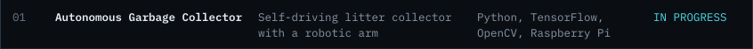</picture></a> 
<a href="https://github.com/ThaskyTech/6-axis-vision-arm"><picture><source media="(max-width: 600px)" srcset="assets/bom-02-mobile.svg">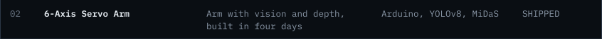</picture></a> 
<a href="https://github.com/Traceback-Technology/BC_Smart_Ecosystem"><picture><source media="(max-width: 600px)" srcset="assets/bom-03-mobile.svg">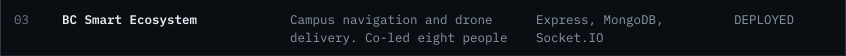</picture></a> 
<a href="https://lethasky.co.za/project-maea.html"><picture><source media="(max-width: 600px)" srcset="assets/bom-04-mobile.svg">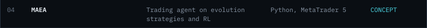</picture></a> 
<a href="https://lethasky.co.za/project-bot.html"><picture><source media="(max-width: 600px)" srcset="assets/bom-05-mobile.svg">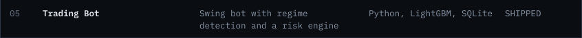</picture></a> 
<a href="https://github.com/TMT-Enterprise/SEN-Civic-Connect---TMT"><picture><source media="(max-width: 600px)" srcset="assets/bom-06-mobile.svg">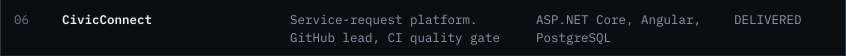</picture></a> 
<a href="https://github.com/ThaskyTech/Personal-Projects/tree/main/abiogenesis/abiogenesis_export"><picture><source media="(max-width: 600px)" srcset="assets/bom-07-mobile.svg">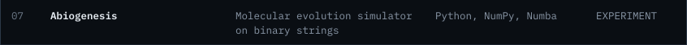</picture></a> 
<a href="https://github.com/ThaskyTech/vista_etude"><picture><source media="(max-width: 600px)" srcset="assets/bom-08-mobile.svg">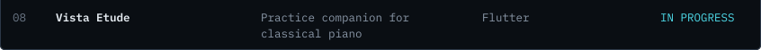</picture></a>

## General notes

1. Open to roles that mix software with hardware, and to freelance work. Willing to relocate. Graduating 2027.
2. Leads the Robotics Club at Belgium Campus: beginner projects, wiring, first programs, basic CAD.
3. Prefers a reliable demo to a half-working one.

## Tools I reach for

<table>
<tr><td><strong>Languages</strong></td><td><code>Python</code> <code>Java</code> <code>C#</code> <code>JavaScript</code> <code>TypeScript</code> <code>SQL</code></td></tr>
<tr><td><strong>Hardware</strong></td><td><code>Arduino</code> <code>Raspberry Pi 5</code> <code>PWM servo control</code> <code>Driver HATs</code> <code>Sensors</code> <code>Power regulation</code></td></tr>
<tr><td><strong>CAD</strong></td><td><code>Fusion 360</code> <code>STL / 3D printing</code></td></tr>
<tr><td><strong>Vision and ML</strong></td><td><code>YOLOv8</code> <code>OpenCV</code> <code>MiDaS</code> <code>TensorFlow</code> <code>LightGBM</code> <code>Reinforcement learning</code></td></tr>
<tr><td><strong>Backend and data</strong></td><td><code>Node.js</code> <code>Express</code> <code>ASP.NET Core</code> <code>REST API design</code> <code>PostgreSQL</code> <code>Prisma</code> <code>MongoDB</code> <code>Mongoose</code> <code>SQLite</code> <code>Socket.IO</code></td></tr>
<tr><td><strong>Security</strong></td><td><code>JWT</code> <code>Session management</code> <code>bcrypt</code> <code>RBAC</code> <code>Stripe integration</code> <code>SQL-injection prevention</code> <code>Fault isolation</code></td></tr>
<tr><td><strong>Frontend</strong></td><td><code>React</code> <code>Flutter</code> <code>Vite</code> <code>Tailwind</code></td></tr>
<tr><td><strong>Engineering practice</strong></td><td><code>Git and GitHub</code> <code>PR review</code> <code>CI pipelines</code> <code>Test definition</code> <code>Technical documentation</code> <code>Agile / Kanban</code> <code>Postman</code> <code>Appium</code></td></tr>
<tr><td><strong>Also worked with</strong></td><td><code>C++</code> <code>Angular</code> <code>Docker</code> <code>Supabase</code> <code>Neon</code> <code>EJS</code></td></tr>
</table>

## Off the clock

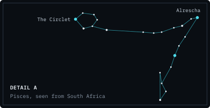 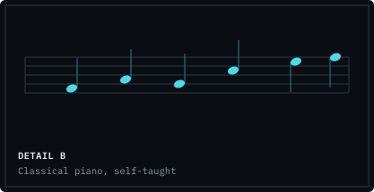

Stargazing, SETI and the Fermi Paradox. Classical piano, which is how item 08 happened. Swimming and hiking.

[lethasky.co.za](https://lethasky.co.za) · [LinkedIn](https://linkedin.com/in/thabang-molise-2aa291336) · [LTMolise@outlook.com](mailto:LTMolise@outlook.com)
